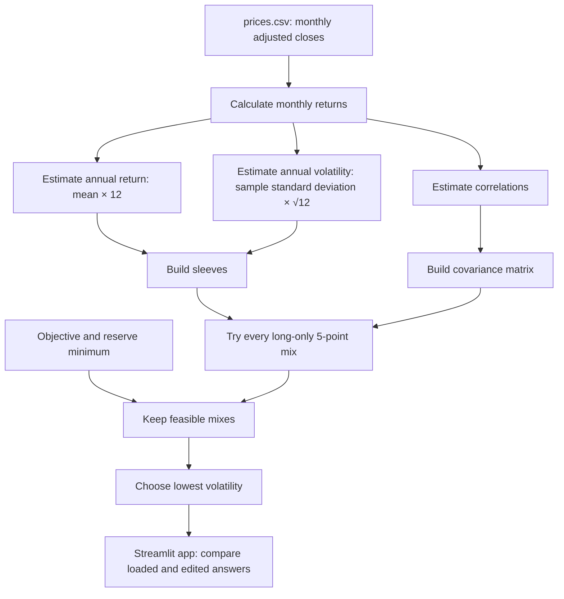

# Lab 15 — Portfolio Stability Decision

## Run

```powershell
cd "Lab 15"
python portfolio.py
streamlit run app.py
```

The Streamlit page starts on the Meridian training inputs. It imports its search, CSV estimation, and Meridian inputs from `portfolio.py`; the app contains no duplicated portfolio math.

## Mandate and data

My Project 2 universe is BIL, IEF, LQD, and VT. BIL and IEF are reserve-eligible. My mandate objective is **CPI + 4% net of costs** over rolling five-year periods. The app needs a numeric nominal input, so its initial **6.5% planning proxy** is explicitly an assumption (2.5% CPI + 4%), not a forecast or a replacement for the mandate. The hard reserve rule is at least **3%** reserve eligible.

`../Lab 14/prices.csv` holds the monthly adjusted-close data used for this lab. It contains 60 complete calendar months, October 2021–September 2026, in oldest-first order. Source and download date: Yahoo Finance Historical Data/chart endpoint for [BIL](https://finance.yahoo.com/quote/BIL/history/), [IEF](https://finance.yahoo.com/quote/IEF/history/), [LQD](https://finance.yahoo.com/quote/LQD/history/), and [VT](https://finance.yahoo.com/quote/VT/history/), downloaded **2026-10-20**. Returns in the app are **annualized arithmetic historical estimates** from monthly adjusted-close returns; history is not a forecast.

## Meridian verification

| Run | Bills / 10-year / IG / equity | Return | Volatility | Largest change |
|---|---:|---:|---:|---:|
| As loaded | 0 / 20 / 25 / 55 | 6.51% | 9.44% | — |
| Set equity estimate from 8.0% to 7.0% | 0 / 10 / 10 / 80 | 6.53% | 12.94% | 25 points |
| Temporarily set IG–equity correlation to 0.50 in both `portfolio.py` cells, refresh | 0 / 40 / 0 / 60 | 6.52% | 9.73% | — |

The one-point lower equity estimate changes the selected allocation by 25 points. The correlation test is a direct engine test: changing `portfolio.py` and refreshing the app changes the app result; restore both correlation cells to 0.25 afterward.

## My universe results

Using `Lab 14/prices.csv`, 6.5% planning objective, 3% reserve minimum, and BIL/IEF reserve eligibility:

| Estimation window | Lowest-risk mix | Return | Volatility | Reserve eligible |
|---|---:|---:|---:|---:|
| All monthly returns | 60% BIL / 0% IEF / 0% LQD / 40% VT | 6.61% | 6.05% | 60% |
| Last 36 monthly returns | 85% BIL / 0% IEF / 0% LQD / 15% VT | 6.75% | 1.79% | 85% |

Both windows are feasible. Their largest weight change is **25 points** (BIL rises from 60% to 85% and VT falls from 40% to 15%).

## Partner attack and my response

Partner attack: **To be completed with my partner during lab.**

Response (two sentences): **To be completed after the partner moves the estimate they distrust most.** This must describe the observed change and the decision implication, not claim a result that was not tested.

## My call

**Pilot, not adopt:** the Meridian stress test shows that reducing one expected-return estimate by one point can move 25 percentage points of the allocation. I would adopt only after the CIO specifies the inflation assumption and a decision rule for resolving the mandate’s unspecified trade-offs (S10).

## Estimation risk

Estimation risk is the chance that inputs estimated from historical data differ from future returns, volatilities, or correlations. An optimizer compares very close combinations, so a small expected-return change can make a different boundary mix become feasible and then allocate heavily to it. My 25-point Meridian weight change shows this amplification: changing the equity estimate by only one percentage point moved a quarter of the portfolio.

## Engine flowchart


